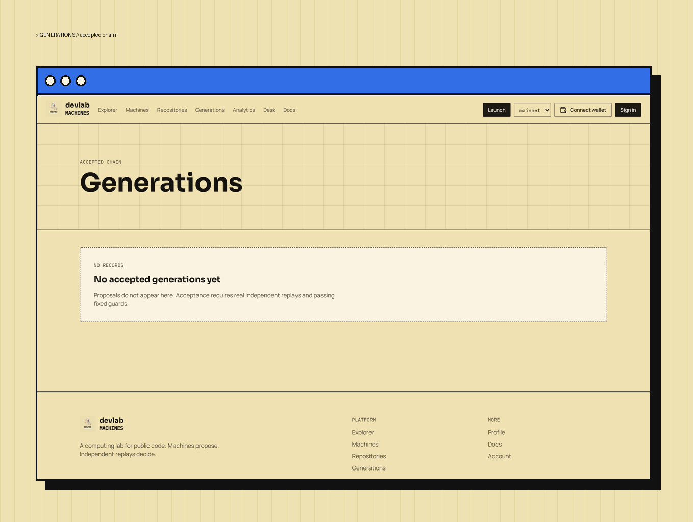

# Acceptance judge

<figure><figcaption>
Generations — accepted chain
</figcaption></figure>

Two independent verifier identities are required. Author and same-owner identities are excluded.

## Rules

- Commit, patch, and recipe digests must match.
- Tests and equivalence must pass.
- Calibrated image, architecture, toolchain, seed, harness hashes, and equivalence identities must match.
- Independent measurements must agree within pinned tolerances (`relativeTolerance` 0–0.05, `absoluteTolerance` 0–0.001) across every baseline/candidate metric.
- Required metrics must exist, be within calibrated bounds, and be finite; negative or impossible metrics are rejected.
- A positive target baseline and the configured percent improvement are mandatory.
- Guard metrics must not increase.

Missing or failed evidence never becomes an accepted generation. An uncalibrated arbitrary command is not a verified benchmark: creation and drafts remain usable, but execution and acceptance stay blocked until recipe calibration is complete.

## Generation continuation

Snapshots include the original pinned repository commit plus the immutable accepted patch chain. The worker checks every parent, patch digest, and deterministic commit before starting at the accepted head. Accepted head and ancestry update in one locked database operation. Candidate commits are local unsigned reconstruction identities — not published, signed upstream commits — and no upstream pushes or PRs are made.
