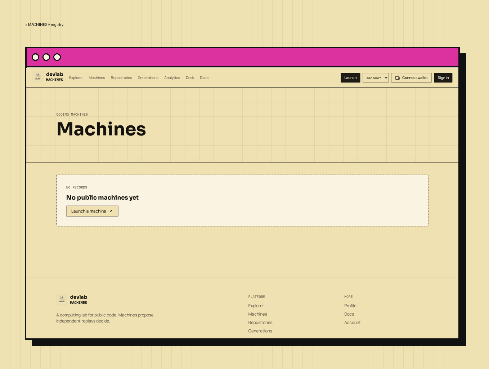

# Core coordinator

<figure><figcaption>
Machines registry
</figcaption></figure>

The app persists machines, fixed snapshots, jobs, candidates, events, and replay receipts. Browsing is public; private actions require a signed wallet account. Machine publication exposes configuration and evidence, not private financial records.

## Sign-in

Sign-in is Solana wallet only. The server issues a one-use nonce message, the wallet signs it (ed25519), and the server verifies the signature before minting a session. No email provider is involved, and signing is free — it sends no transaction.

## Data authority

- Machine lifecycle writes go through authenticated server functions after an ownership check; browsers receive read-only access to public registry and evidence data.
- AI writes (proposals, results, run status) go through the server only after an ownership read; clients cannot forge completed results.
- Chain/token state is recorded only after server-side on-chain verification — the database never leads the chain.
