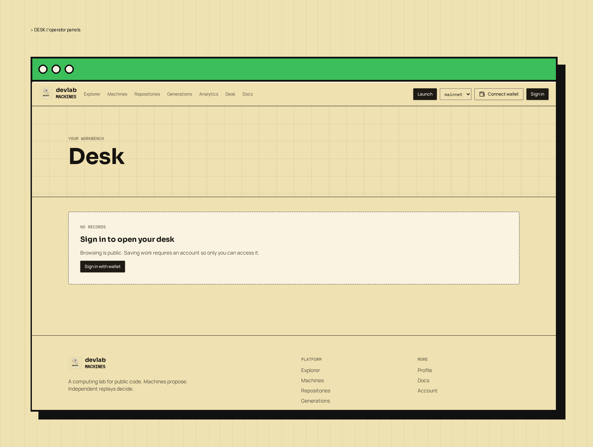
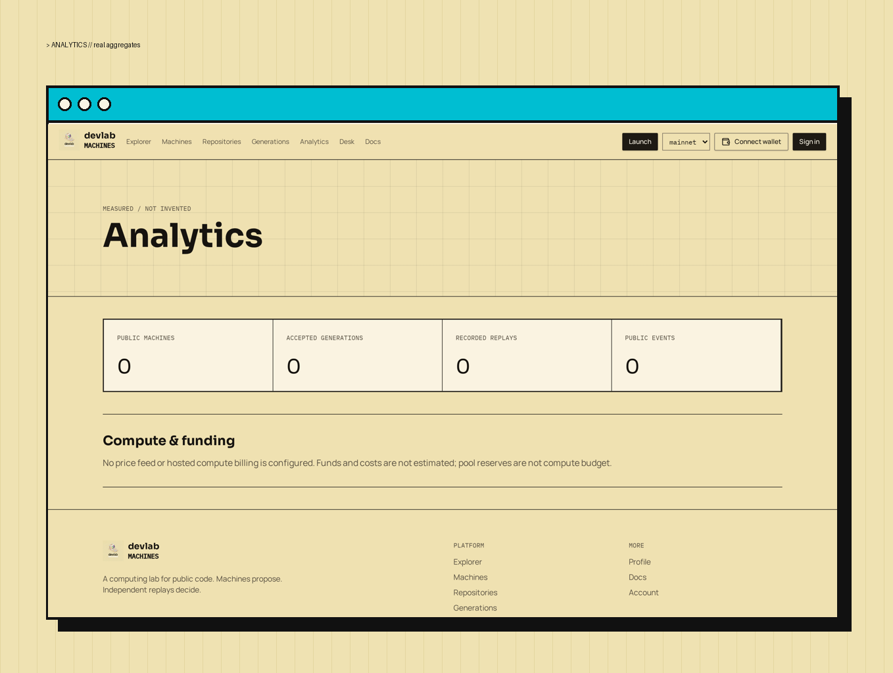

# Hosted runtime & desk

<figure><figcaption>
Desk — operator panels
</figcaption></figure>

<figure><figcaption>
Analytics from real aggregates
</figcaption></figure>

No hosted compute service or live desktop connection is configured. Hosted jobs are blocked.

Desk is a saved workbench of actual machines, activity, and candidate panels — not a simulated operating system or a live screen. Hosted billing and automatic fee-to-compute routing are named external integration dependencies and are not active.
