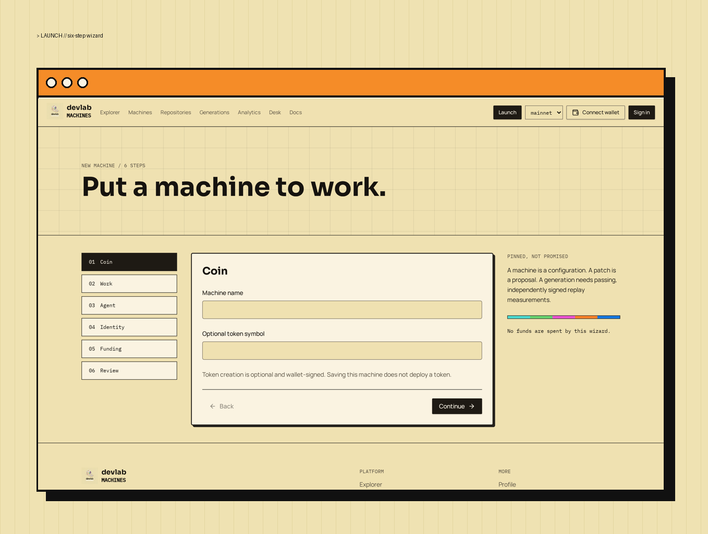
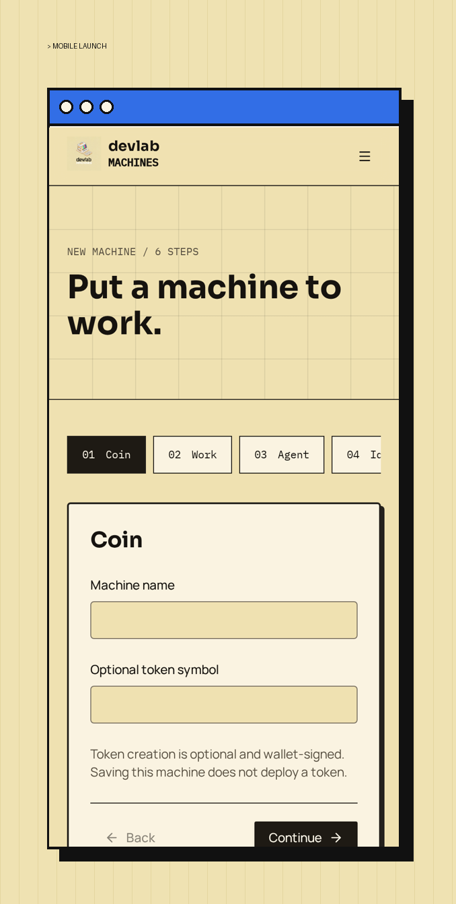

# Pinned work

<figure><figcaption>
Six-step launch wizard
</figcaption></figure>

<figure><figcaption>
Launch on mobile
</figcaption></figure>

GitHub metadata, default branch, exact commit, license, and README are fetched from the official GitHub API. Repository roots must be public HTTPS `github.com` URLs. A changed commit requires a new review. No arbitrary URL fetches. Missing licenses are shown explicitly.

## Fetch protections

- Fixed host allowlist (`api.github.com` only).
- Manual redirect handling: any 3xx response is rejected explicitly.
- Bounded timeouts (15s) and response size limits (250 KB).
- Honest errors for not-found and rate-limit responses.
- An optional server-only `GITHUB_TOKEN` lifts the anonymous rate limit. It is readable only by the backend at runtime — never sent to the browser, the runner kit, or logs.
