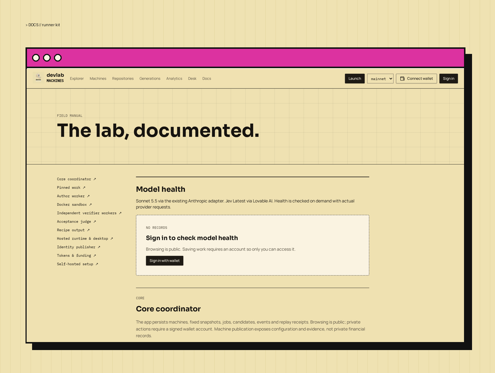

# Self-hosted runner setup

<figure><figcaption><p>Docs page with runner kit download</p></figcaption></figure>


Download the runner package from the app's Docs page (`devlab-runner-v2.1.0.zip`, with a `.sha256` alongside). You need your own author runner plus two verifier runners enrolled from two separate other accounts, each on a dedicated Linux host with Docker and an actually calibrated, dependency-ready image whose immutable ID is pinned in the recipe.

The archive contains only `worker.py`, `devlab_enroll.py`, `requirements.txt`, `Dockerfile`, the systemd service, `README.md`, and a blank env template. No credentials. Keys are generated and kept on the host; only the public key and a challenge signature are pasted into the app.

## Host requirements

- Dedicated Linux VM, Python 3.11+, Docker Engine. A Docker-group coordinator effectively controls its host: never share it with production workloads.
- Repository checkout on a filesystem quota capped at 256 MB.
- Disable Docker container logging or cap daemon log sizes.
- Keep host credentials outside the checkout; do not mount the home directory or Docker socket into containers.

## Install

```bash
unzip devlab-runner-v2.1.0.zip && cd devlab-runner-v2.1.0
sudo useradd --system devlab-runner && sudo usermod -aG docker devlab-runner
sudo install -d -o devlab-runner /opt/devlab /var/lib/devlab
sudo install -d -m 0700 -o devlab-runner /etc/devlab
sudo cp -r . /opt/devlab/runner
sudo -u devlab-runner python3 -m venv /opt/devlab/venv
sudo -u devlab-runner /opt/devlab/venv/bin/pip install -r requirements.txt
```

## 1. Generate the signing key locally (prints the PUBLIC key only)

```bash
sudo -u devlab-runner /opt/devlab/venv/bin/python devlab_enroll.py keygen --out /etc/devlab/signing.key
```

## 2. Request and sign the enrollment challenge

In the app: machine → Settings → Enroll isolated runner → Request enrollment challenge. Save the challenge text exactly as `challenge.txt`, then:

```bash
sudo -u devlab-runner /opt/devlab/venv/bin/python devlab_enroll.py sign --key /etc/devlab/signing.key --challenge challenge.txt
```

## 3. Prove the key and configure the environment

Paste the signature → **Prove key and enroll**. Copy the one-time credential into the env file:

```bash
sudo install -m 0600 -o devlab-runner runner.env.example /etc/devlab/runner.env
sudoedit /etc/devlab/runner.env   # DEVLAB_URL, DEVLAB_RUNNER_TOKEN
```

## 4. Start the service

```bash
sudo cp devlab-runner.service /etc/systemd/system/
sudo systemctl daemon-reload && sudo systemctl enable --now devlab-runner
```

## Calibration

Execution is blocked until Settings → Recipe calibration JSON contains an immutable image ID, architecture, toolchain, holdout seed, SHA-256 of every harness file, ordered test identities, expected equivalence digest, exact metric bounds, and agreement tolerances. See [Recipe output](recipe-output.md).

## Verification

```bash
python3 -m unittest discover -s runner -p 'test_*.py'
```

exercises pure chain rules without executing Git commands. Real commit reconstruction and Docker runs need the dedicated host.
